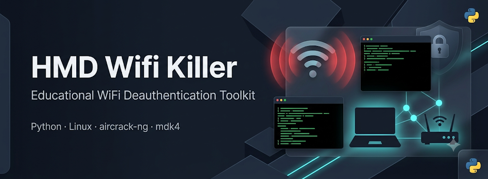

<div align="center">



<h1>HMD Wifi Killer — Educational WiFi Deauthentication Toolkit</h1>

[English](#english) · [فارسی](#فارسی)


**Python • Linux • aircrack-ng • mdk4**

</div>

---

## English

### Overview

**HMD Wifi Killer** is an interactive CLI toolkit for studying and testing WiFi deauthentication behavior in controlled environments. It discovers wireless interfaces, scans nearby networks, and can run deauth flows through **mdk4** or **aircrack-ng**.

> **Legal notice:** Use this software only on networks you own or have explicit written authorization to test. Unauthorized use is illegal. The author assumes no liability for misuse.

### Features

| Feature | Description |
|---|---|
| Interactive scanning | Discover nearby access points with channel and BSSID details |
| Dual attack backends | Choose **mdk4** (aggressive) or **aircrack-ng** (stable) |
| Interface detection | Automatically lists IEEE 802.11 wireless adapters |
| Monitor mode setup | Enables monitor mode on the selected interface |
| Dependency checks | Verifies root access and required system tools |
| Colored CLI | Clear terminal feedback for scan and attack status |

### Requirements

- **OS:** Linux
- **Runtime:** Python 3.x
- **Privileges:** Root (`sudo`)
- **Hardware:** Wireless adapter with monitor-mode support

#### System packages

```bash
sudo apt update
sudo apt install aircrack-ng mdk4
```

#### Python packages

```bash
pip install -r requirements.txt
```

Core libraries used by the tool: `scapy`, `termcolor`.

### Installation

```bash
git clone https://github.com/Hamed-Gharghi/wifi-deauther.git
cd wifi-deauther
chmod +x wifi_deauther.py
```

### Usage

Launch the interactive menu:

```bash
sudo python3 wifi_deauther.py
```

Typical flow:

1. Select a wireless interface
2. Choose an attack backend (`mdk4` or `aircrack-ng`)
3. Pick a target network (or all networks)
4. Stop with `Ctrl+C`

#### Command-line options

```text
-i, --interface   Wireless interface name
-t, --target      Target WiFi BSSID (MAC address)
-g, --gateway     Gateway MAC address (optional)
-n, --count       Number of deauthentication packets (default: 1000)
```

Example:

```bash
sudo python3 wifi_deauther.py -i wlan0 -t AA:BB:CC:DD:EE:FF -n 2000
```

### Attack methods

| Method | Strengths | Best for |
|---|---|---|
| **mdk4** | Higher packet rate; can focus on clients | Aggressive lab testing |
| **aircrack-ng** | More stable; lower resource use | Broader adapter compatibility |

### Project structure

```text
wifi-deauther/
├── wifi_deauther.py   # Main CLI application
├── requirements.txt   # Python dependencies
├── LICENSE            # MIT License
├── image.png          # Project banner
└── README.md          # Documentation (EN / FA)
```

### Disclaimer

This project is intended strictly for education, research, and authorized security testing. Running deauthentication attacks without permission may violate local laws and network policies. Always obtain consent before testing.

### License

Released under the [MIT License](LICENSE).

### Author

**Hamed Gharghi**  
GitHub: [@Hamed-Gharghi](https://github.com/Hamed-Gharghi)

If this project helps your learning or lab work, consider starring the repository.

---

<div dir="rtl">

## فارسی

### معرفی

**HMD Wifi Killer** یک ابزار خط فرمان تعاملی برای مطالعه و تست رفتار deauthentication در شبکه‌های وای‌فای در محیط‌های کنترل‌شده است. این ابزار رابط‌های بی‌سیم را شناسایی می‌کند، شبکه‌های اطراف را اسکن می‌کند و امکان اجرای حمله از طریق **mdk4** یا **aircrack-ng** را فراهم می‌کند.

> **هشدار قانونی:** این نرم‌افزار را فقط روی شبکه‌هایی استفاده کنید که مالک آن هستید یا مجوز کتبی صریح برای تست دارید. استفاده غیرمجاز غیرقانونی است. نویسنده هیچ مسئولیتی در قبال سوءاستفاده نمی‌پذیرد.

### قابلیت‌ها

| قابلیت | توضیحات |
|---|---|
| اسکن تعاملی | کشف نقاط دسترسی اطراف همراه با کانال و BSSID |
| دو موتور حمله | انتخاب **mdk4** (تهاجمی) یا **aircrack-ng** (پایدار) |
| تشخیص رابط شبکه | فهرست خودکار آداپتورهای بی‌سیم IEEE 802.11 |
| فعال‌سازی حالت مانیتور | تنظیم monitor mode روی رابط انتخاب‌شده |
| بررسی وابستگی‌ها | تأیید دسترسی root و ابزارهای سیستمی مورد نیاز |
| رابط رنگی | بازخورد واضح وضعیت اسکن و حمله در ترمینال |

### نیازمندی‌ها

- **سیستم‌عامل:** لینوکس
- **زمان اجرا:** Python 3.x
- **دسترسی:** Root (`sudo`)
- **سخت‌افزار:** کارت شبکه بی‌سیم با پشتیبانی از حالت مانیتور

#### بسته‌های سیستمی

```bash
sudo apt update
sudo apt install aircrack-ng mdk4
```

#### بسته‌های پایتون

```bash
pip install -r requirements.txt
```

کتابخانه‌های اصلی: `scapy` و `termcolor`.

### نصب

```bash
git clone https://github.com/Hamed-Gharghi/wifi-deauther.git
cd wifi-deauther
chmod +x wifi_deauther.py
```

### نحوه استفاده

اجرای منوی تعاملی:

```bash
sudo python3 wifi_deauther.py
```

مراحل معمول:

1. انتخاب رابط شبکه بی‌سیم
2. انتخاب موتور حمله (`mdk4` یا `aircrack-ng`)
3. انتخاب شبکه هدف (یا همه شبکه‌ها)
4. توقف با `Ctrl+C`

#### گزینه‌های خط فرمان

```text
-i, --interface   نام رابط شبکه بی‌سیم
-t, --target      آدرس MAC (BSSID) شبکه هدف
-g, --gateway     آدرس MAC گیت‌وی (اختیاری)
-n, --count       تعداد بسته‌های deauthentication (پیش‌فرض: 1000)
```

مثال:

```bash
sudo python3 wifi_deauther.py -i wlan0 -t AA:BB:CC:DD:EE:FF -n 2000
```

### روش‌های حمله

| روش | نقاط قوت | مناسب برای |
|---|---|---|
| **mdk4** | نرخ بسته بالاتر؛ امکان تمرکز روی کلاینت‌ها | تست آزمایشگاهی تهاجمی |
| **aircrack-ng** | پایدارتر؛ مصرف منابع کمتر | سازگاری گسترده‌تر با آداپتورها |

### ساختار پروژه

```text
wifi-deauther/
├── wifi_deauther.py   # برنامه اصلی CLI
├── requirements.txt   # وابستگی‌های پایتون
├── LICENSE            # مجوز MIT
├── image.png          # بنر پروژه
└── README.md          # مستندات (انگلیسی / فارسی)
```

### سلب مسئولیت

این پروژه صرفاً برای آموزش، پژوهش و تست امنیتی مجاز طراحی شده است. اجرای حملات deauthentication بدون مجوز ممکن است خلاف قوانین محلی و سیاست‌های شبکه باشد. همیشه قبل از تست رضایت بگیرید.

### مجوز

تحت [مجوز MIT](LICENSE) منتشر شده است.

### نویسنده

**حامد غرقی**  
GitHub: [@Hamed-Gharghi](https://github.com/Hamed-Gharghi)

اگر این پروژه به یادگیری یا کار آزمایشگاهی شما کمک کرد، به مخزن ستاره بدهید.

</div>

---

<div align="center">

Made by [Hamed Gharghi](https://github.com/Hamed-Gharghi) · ساخته شده توسط [حامد غرقی](https://github.com/Hamed-Gharghi)

</div>
****
